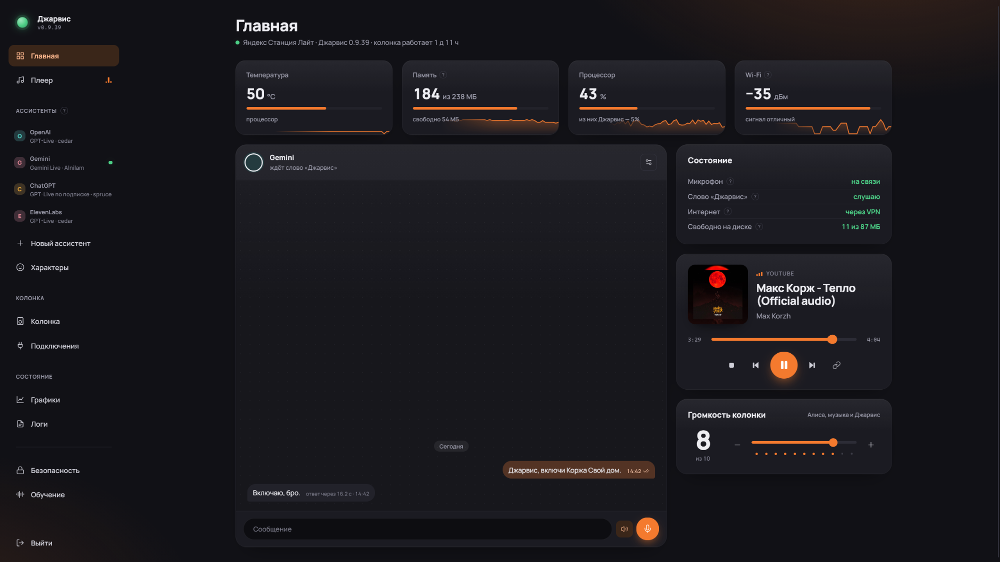
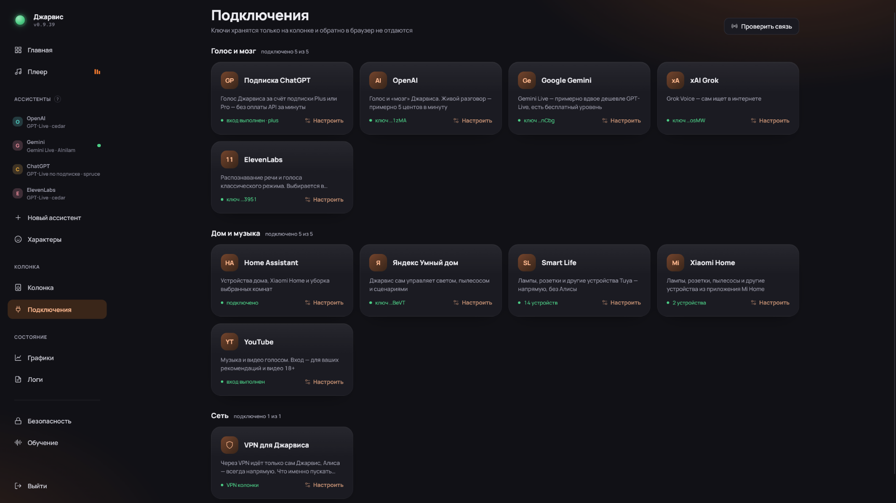
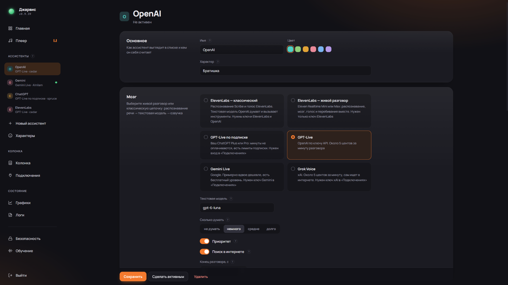
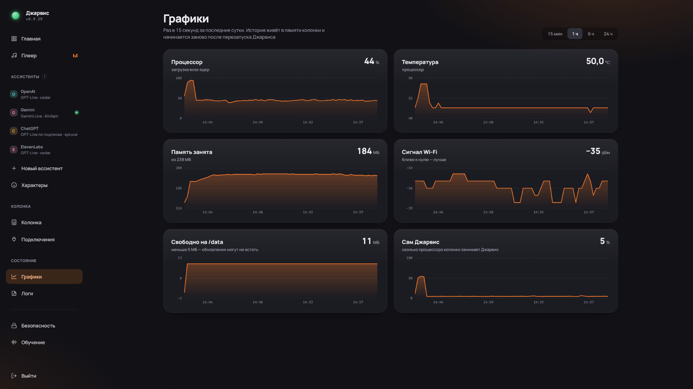

# YaJavis — Джарвис для Яндекс Станции

Голосовой помощник на вашей колонке: локальное слово «Джарвис», выбор облачного голосового движка, музыка с YouTube, управление умным домом и веб-панель. Отдельный сервер для работы не нужен.

**[Скачать последнюю версию](https://github.com/newfpv/YaJavis/releases/latest)** · **[Сообщить об ошибке](https://github.com/newfpv/YaJavis/issues)**

Если проект пригодился — поставьте **Star** на GitHub.



## Быстрая установка

Нужна колонка с уже полученным root-доступом и ADB по сети. Компьютер и колонка должны находиться в одной локальной сети. Команда скачает установщик, который откроет страницу в браузере: выберите колонку, задайте пароль и нажмите «Установить».

**Windows — откройте PowerShell:**

```powershell
irm https://github.com/newfpv/YaJavis/releases/latest/download/install.ps1 | iex
```

**macOS и Linux — откройте терминал:**

```sh
curl -fsSL https://github.com/newfpv/YaJavis/releases/latest/download/install.sh | sh
```

Скрипт для macOS и Linux сам выбирает x64 или ARM64. На Windows доступна сборка x64. Можно предварительно просмотреть скрипты либо [скачать установщик вручную](https://github.com/newfpv/YaJavis/releases/latest).

После установки откройте `http://IP-КОЛОНКИ:8080`, добавьте свои ключи или войдите в поддерживаемый аккаунт и выберите ассистента. Свой сервер и отдельная установка ADB на компьютер не нужны.

## Возможности

- Локальное распознавание слова «Джарвис»; звук активации не требуется отправлять в облако.
- Голосовые движки OpenAI Realtime, Gemini Live, Grok Voice и ElevenLabs. Классический режим: распознавание → языковая модель → синтез речи.
- Экспериментальный вход через аккаунт ChatGPT. Доступность зависит от аккаунта и изменений сервиса; это не гарантия работы по любой подписке.
- Несколько ассистентов со своими голосами, моделями и характерами.
- YouTube: поиск, очередь, похожие треки, пауза, продолжение и перемотка.
- Отображение музыки штатной Алисы и согласование воспроизведения с YouTube. Яндекс Музыку для запросов Джарвису можно отключить отдельно.
- Умный дом через Алису, API Яндекса, Smart Life / Tuya, Xiaomi Home и Home Assistant.
- Громкость, подсветка, ночной режим, журнал и графики в браузере.
- Обновления из GitHub Releases с проверкой SHA-256; ручная установка файла также доступна.

## Что понадобится

- Собственная Яндекс Станция с уже полученным root-доступом и доступным ADB по сети.
- Компьютер в той же локальной сети для установки.
- Интернет и ваш ключ поддерживаемого сервиса либо доступный способ входа в аккаунт.
- При необходимости — собственное подключение VLESS для сервисов, недоступных в вашей сети.

Установщик сам определяет модель по идентификаторам платы, выбирает программу ARM64/ARMv7 и библиотеку микрофона по ELF-разрядности штатной Алисы. Вручную выбирать Лайт или Миди не нужно. Определение модели и проверка совместимости прошивки выполняются отдельно.

| Модели | Автоопределение |
| --- | --- |
| Лайт, Лайт 2 | Micro, Plum |
| Мини, Мини 2, Мини 3, Мини 3 Про | Mini, Mini2, Bergamot, Pickle |
| Миди | Cucumber |
| Станция 2, Станция 3 | Station Midi / yandexmidi, Orion |
| Стрит | Mango |
| Макс, Станция первого поколения | Определяются, но текущая установка на Android не поддерживается |

Внутреннее имя `station-midi` относится к Станции 2, а розничная Миди — к Cucumber: установщик различает их. Соответствия описаны в [каталоге устройств Yandex Station Extended](https://hackalice.me/devices/).

Полный голосовой тракт проверен на **Яндекс Станции Лайт первого поколения**. На остальных моделях статус экспериментальный: установщик проверяет root, архитектуру, профиль `maind --platformd`, механизм запуска и наличие `aplay`. Без необходимых компонентов установка останавливается с объяснением. Умный хаб не поддерживается. Получение root-доступа в проект не входит.

## Панель управления

Скриншоты показывают пример настроенной панели. Новая установка использует стандартные настройки: аккаунты не подключены, город не заполнен, часовой пояс — UTC.

**Подключения.** Голосовые сервисы, умный дом, музыка и VPN в одном месте.



**Ассистенты.** Выбор движка, модели, характера и голоса для каждого профиля.



**Графики.** Загрузка процессора, память, температура, Wi-Fi и место на диске.



## Установка

1. Откройте [последний релиз](https://github.com/newfpv/YaJavis/releases/latest).
2. Скачайте установщик для своей системы и запустите его.
3. В открывшейся странице выберите найденную колонку или введите её локальный IP.
4. Задайте пароль панели и установите YaJavis. Затем добавьте свои подключения и выберите ассистента.

| Система | Файл |
| --- | --- |
| Windows x64 | `JarvisSetup-windows-amd64.exe` |
| Linux x64 | `JarvisSetup-linux-amd64` |
| Linux ARM64 | `JarvisSetup-linux-arm64` |
| macOS Intel | `JarvisSetup-darwin-amd64` |
| macOS Apple Silicon | `JarvisSetup-darwin-arm64` |

На Linux и macOS перед запуском дайте установщику право выполнения: `chmod +x JarvisSetup-*`. Сборки не подписаны сертификатом разработчика.

Установка из терминала также доступна после просмотра скрипта:

```powershell
# Windows PowerShell
irm https://github.com/newfpv/YaJavis/releases/latest/download/install.ps1 | iex
```

```sh
# Linux / macOS
curl -fsSL https://github.com/newfpv/YaJavis/releases/latest/download/install.sh | sh
```

Панель открывается по адресу `http://IP-КОЛОНКИ:8080`. Город изначально не задан, часовой пояс — UTC. Укажите свои значения во вкладке «Колонка».

## Обновления

Откройте **Безопасность → Обновления → Проверить → Обновить**. Источник по умолчанию — `newfpv/YaJavis`. Программа выбирает файл под архитектуру колонки и сверяет его с `SHA256SUMS` из релиза.

Проверка новых версий включена по умолчанию, автоматическая установка — выключена. Её можно включить в панели: обновление устанавливается ночью, когда колонка не занята. Перезапуск прерывает воспроизведение и разговор. Для ручной загрузки нужен `jarvisd-arm64` или `jarvisd-armv7`, а не установщик для компьютера.

## Данные и подключения

Публичные исходники и релизы не содержат настроек автора, личных API-ключей, адресов его устройств, истории разговоров или записей микрофона. Каждый пользователь подключает свои аккаунты. Настройки и токены сохраняются локально на колонке в `/data/opt/jarvisd`; доступ к файлу настроек ограничен правами `0600`.

Распознавание активации работает локально. Во время разговора аудио и запросы передаются выбранным облачным сервисам. Штатная Алиса продолжает использовать инфраструктуру Яндекса. Это не полностью автономный или офлайн-ассистент.

Запись фона и обучение включаются отдельно в режиме разработчика и по умолчанию выключены. В официальных сборках общий OAuth-клиент Google позволяет подключить Диск по коду; доступ запрашивается только к файлам приложения (`drive.file`). Вход, личный refresh-токен и файлы каждого пользователя остаются отдельными. Для этой функции может потребоваться разрешение доступа к приложению в Google.

Общие реквизиты OAuth-приложения упакованы с AES-GCM при сборке. Это скрывает строки от случайного просмотра, но **не делает секрет конфиденциальным**: ключ расшифровки входит в программу. Личные учётные данные таким способом не распространяются.

Не публикуйте свои `settings.json`, `seed.json`, логи, архивы обучения и записи. Панель предназначена для доверенной локальной сети; не открывайте её напрямую в интернет.

## Сборка из исходников

Нужны Go версии из `jarvisd/go.mod`, Zig с поддержкой указанных Linux-целей и POSIX shell. Python и видеокарта для обычной сборки не требуются. Обученные классификаторы активации входят в `models/`; исходные аудиозаписи не распространяются.

```sh
git clone https://github.com/newfpv/YaJavis.git
cd YaJavis
(cd jarvisd && go test ./...)
VERSION=0.9.41 RELEASE=1 sh build.sh
```

Если Go или Zig отсутствуют в `PATH`, укажите `GO=/путь/к/go ZIG=/путь/к/zig`. Результат — `build/release/`, включая установщики, файлы колонки и `SHA256SUMS`. Сборка никогда не читает локальные `.env` или настройки автоматически.

Без переменных `GDRIVE_CLIENT` и `GDRIVE_SECRET` сборка работает без общего Google OAuth-клиента. Для официальных релизов эти два значения берутся из GitHub Actions Secrets; сгенерированный файл с зашифрованным приложением не входит в Git и удаляется после сборки. Прочие ключи в сборку не передаются.

Тег вида `v0.9.41` запускает `.github/workflows/release.yml`: тесты, сборку и публикацию релиза. Для локальных сетевых проверок используйте выборочные тесты с `JARVIS_NET=1`; обычный запуск тестов не требует входа в аккаунты.

## Структура

| Каталог | Назначение |
| --- | --- |
| `jarvisd/` | Программа колонки и веб-панель |
| `installer/` | Установщик с собственным ADB-клиентом |
| `station/` | Подключение микрофона и запуск сервиса |
| `models/` | Веса распознавания активации |
| `kws/` | Дополнительные инструменты обучения на своих записях |
| `scripts/` | Инструменты сборки |

Для удаления запустите установщик и выберите удаление. Он также используется для восстановления установки.

## Лицензии и благодарности

Исходный код YaJavis распространяется под MIT; сторонние компоненты сохраняют свои лицензии. См. [THIRD_PARTY.md](THIRD_PARTY.md) и [LICENSES](LICENSES).

Спасибо сообществу [yandex-station-extended](https://github.com/Marker284/yandex-station-extended), проектам [openWakeWord](https://github.com/dscripka/openWakeWord), [yt-dlp](https://github.com/yt-dlp/yt-dlp), [goja](https://github.com/dop251/goja) и [Xray-core](https://github.com/XTLS/Xray-core).

YaJavis — независимый проект сообщества, не официальный продукт Яндекса, OpenAI, Google, xAI или ElevenLabs.
